# Eddy's 3D Plugins for IngeTrazo

A set of plugins (extensions) for [IngeTrazo](https://github.com/ingelibre/ingetrazo) for modelling
buildings and details, made for model railway buildings at 1:80 and 3D printing with a 0.4 mm
nozzle. All sizes are entered in real-world millimetres, so they work just as well at full size
or any other scale.

Every part they make is a closed, watertight solid with flat faces, ready to print.

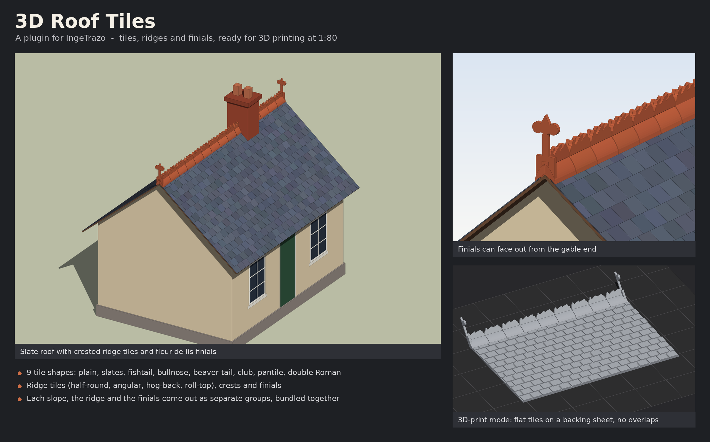

## The plugins

| Plugin | Shortcut | What it does |
|---|---|---|
| 3D Brick & Block Studio | Ctrl+Shift+T | Brick and block work on a wall face: bonds, row offsets, header courses, soldier courses round openings, weathering, presets, exact cuts round windows and doors. |
| 3D Period Windows | Ctrl+Alt+N | Sash, casement and industrial windows that fit the selected face, with round tops, panes, sills, heads and keystones. |
| 3D Period Doors | Ctrl+Alt+D | Panelled, half-glazed, ledged and braced, stable and sliding goods doors, with fanlights, steps, heads and keystones. |
| 3D Roof Tiles | Ctrl+Alt+R | Plain tiles, slates, shaped and profiled tiles, overlapping or flat for printing, with ridge tiles and finials. Each slope, the ridge and the finials are grouped separately. |
| 3D Wood Planking | Ctrl+Alt+O | Timber boarding: flat, V-jointed, shiplap, weatherboard, board and batten or logs, with trims round openings, corner boards and derelict effects (rotted bottoms, holes, missing and skewed boards). |
| 3D Fences & Gates | Ctrl+Alt+F | Picket, close-boarded, panel, post and rail, post and wire, steel palisade and iron railings on a dwarf wall, with gates and weathering. |
| 3D Gutters & Downpipes | Ctrl+Alt+G | Gutters, downpipes and fittings that join onto each other, with presets. |
| 3D Soil & Waste Pipes | Ctrl+Alt+W | Soil stacks and outside waste pipes with fittings that join onto each other, with presets. |
| 3D Wrap | Ctrl+Alt+U | Lays bricks course by course around round, square, many-sided or drawn chimneys (no seam, bonded corners, level courses stepping in up a taper), or bends any flat pattern round a solid. |
| 3D Chimneys | Ctrl+Alt+H | House chimney stacks that stand on the roof faces you pick, every brick cut to the slope, with oversailing courses, flaunching and pots; industrial mill and factory chimneys (square, octagonal or round, tapered, with plinth, bands, corbelled cap and coping); and six styles of chimney pot. |
| 3D Corrugated Iron | Ctrl+Alt+I | Corrugated, box-profile and flat sheet cladding for walls and roofs, round any openings: flat-backed for 3D printing (joint lines and end-lap steps) or real lapped sheets on rails. Rust holes, rusted ragged bottoms, missing, skew and lifted sheets, flashings and corner trims. |
| 3D Station Canopies | Ctrl+Alt+C | Railway platform canopies: lean-to off a building's wall, island / umbrella over a platform (ridged or butterfly roof), and ridge and furrow with glazed ridges. Cast-iron columns with pierced spandrels or timber posts with knee braces, plain or glazed roofs, and dagger, rounded, fleur, saw-tooth or plain valancing as one flat printable strip. Live 3D preview and a lettered Sizes drawing. |
| 3D Loft | Ctrl+Alt+L | Makes a solid between two or more profile faces, such as a square into a circle. |
| 3D Centre Finder | Ctrl+Alt+M | Finds the centre of a face, an edge or an object and shows its size: marks the centre with a guide point or centre lines, or moves another object so its centre lands there (a door central on a wall, a vent on a roof). |
| 3D Print Scaler | Ctrl+Alt+P | Scales the selected object to a chosen scale for printing and checks it fits your print bed. Exports STL, 3MF, OBJ or PLY in mm with full detail, can split a model into a separate part per group laid out on the bed (separate items in one 3MF), opens it in your slicer, and can stay open for scaling lots of parts. Model railway scales built in, plus your own. |
| 3D Scale Converter | Ctrl+Alt+K | A toolbar that turns real sizes (ft / in / mm) into model sizes at any scale. |
| 3D Notepad | Ctrl+Alt+J | A note pad that stays on screen and saves itself, with a real-to-model size converter. |
| 3D Plugins Toolbar | Ctrl+Alt+B | A toolbar with a button for each plugin, and a "3D Plugins by Eddy" submenu under Extensions. |
| 3D Better Icons | Ctrl+Alt+Y | Clearer colour icons for IngeTrazo's own toolbar buttons, drawn sharp at any size, with optional names under the icons (Ctrl+Alt+Q turns the names on or off). Remove the file to get the original icons back. |

Every window has pop-up notes on its boxes when you hover over them, and opens where you last
left it.

## Installing

All the plugins live in one folder, **3D_Eddys**, so they stay together and don't get mixed up
with other people's plugins. Every file in it starts with `ed3d_`, so you can tell at a glance
it's one of this set.

1. Download the files: click the green **Code** button above, then **Download ZIP**, and unzip it.
2. In IngeTrazo, choose **Extensions > Open extensions folder**.
3. Copy the whole **3D_Eddys** folder (from inside the `plugins` folder) into that folder.
4. Restart IngeTrazo. The plugins appear under **Extensions > 3D Plugins by Eddy**, and on the
   3D Plugins toolbar.

**Upgrading from the loose files?** Earlier versions put each plugin straight in the extensions
folder (`period_windows.py`, `roof_tiles.py` ...). Delete those old files when you copy the
3D_Eddys folder in, or you'll get every tool twice.

**Leaving one out:** rename its file inside 3D_Eddys so it no longer ends in `.py`
(for example `ed3d_loft.py.off`).

**Just one plugin?** You can also copy a single `ed3d_...py` file straight into the extensions
folder on its own - it works the same.

## Pictures

| | |
|---|---|
| 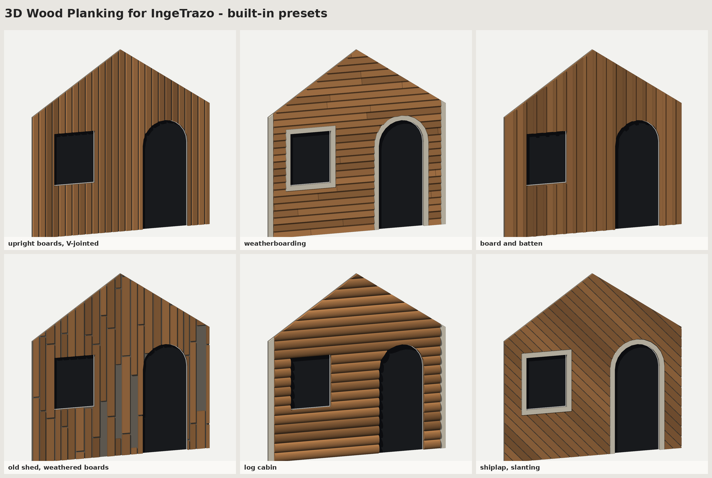 | 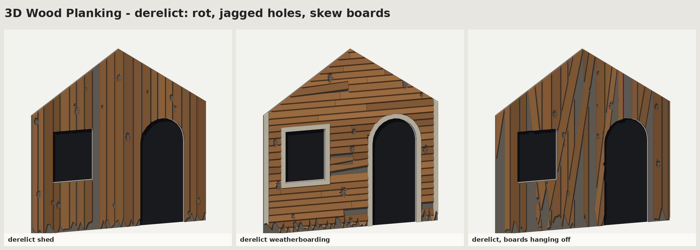 |
| 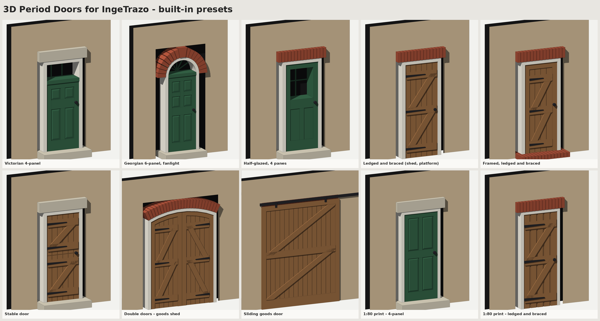 | 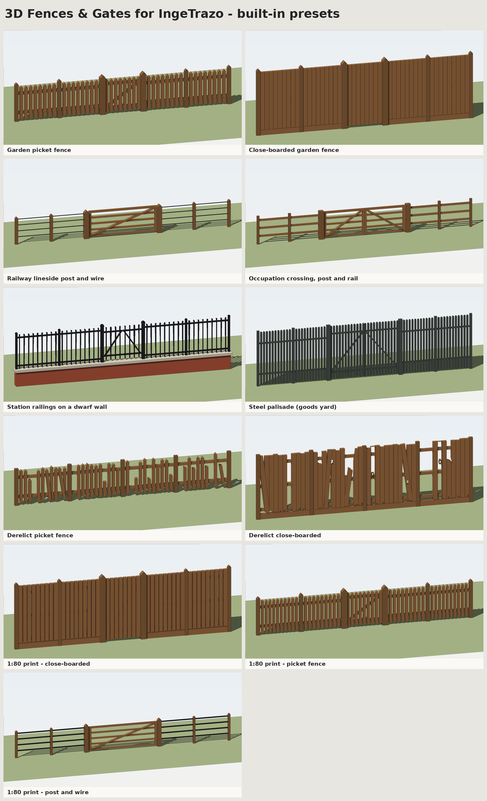 |
| 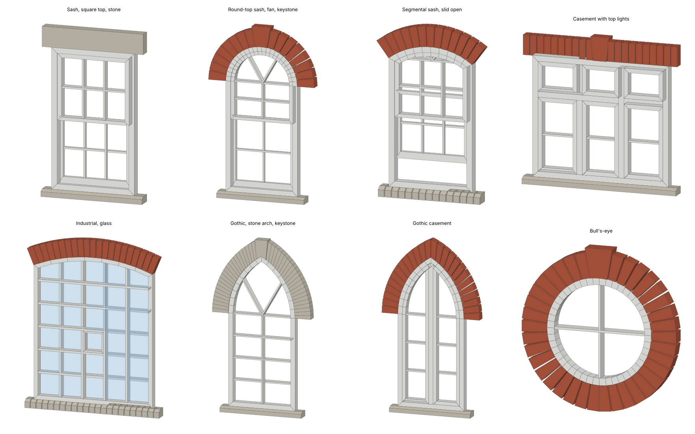 | 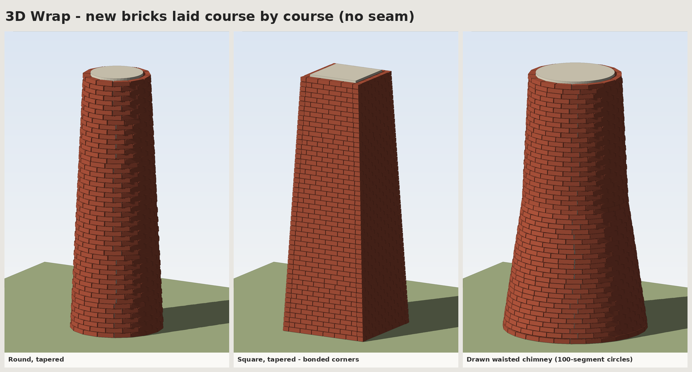 |
| 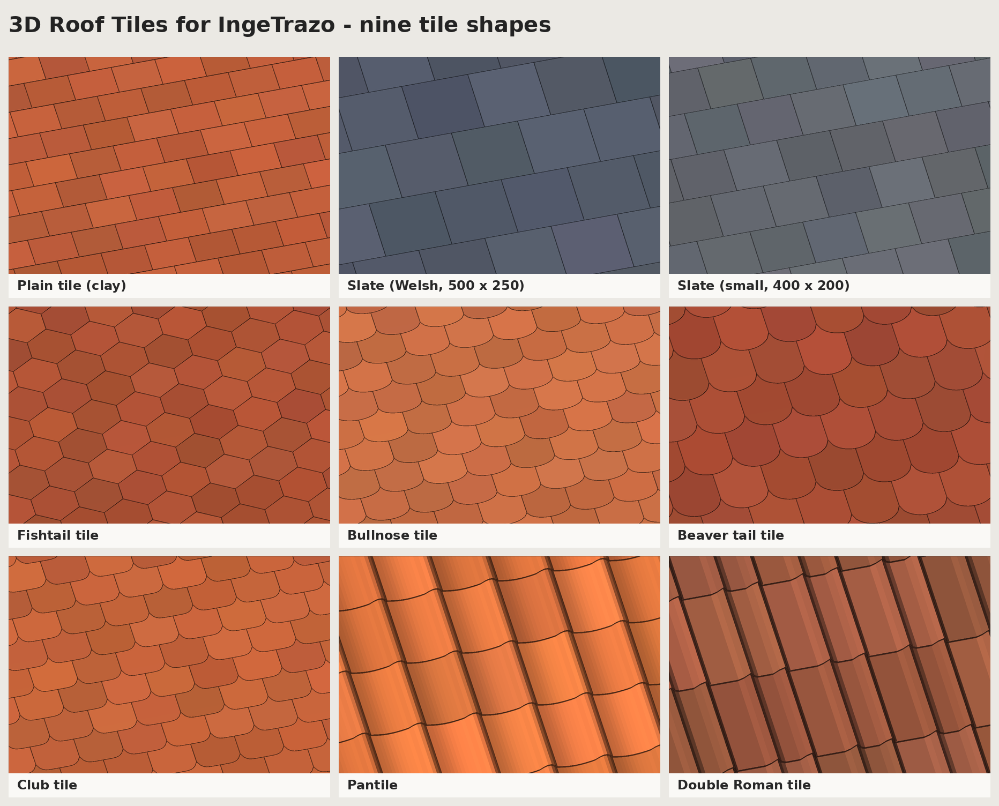 | 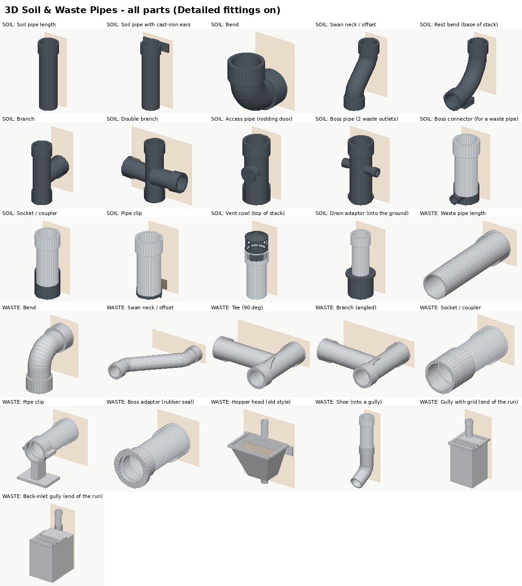 |

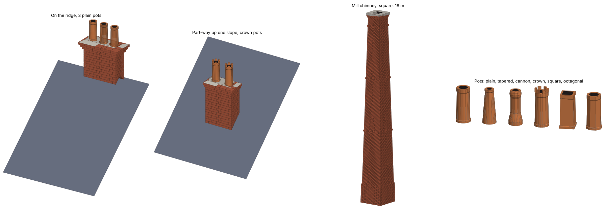

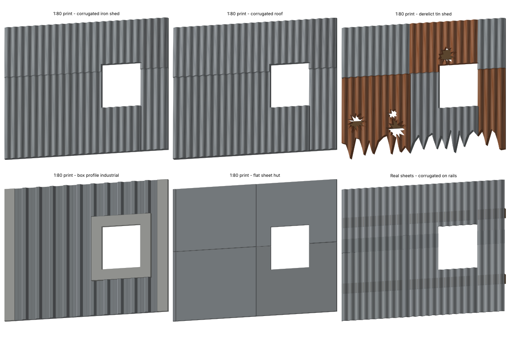

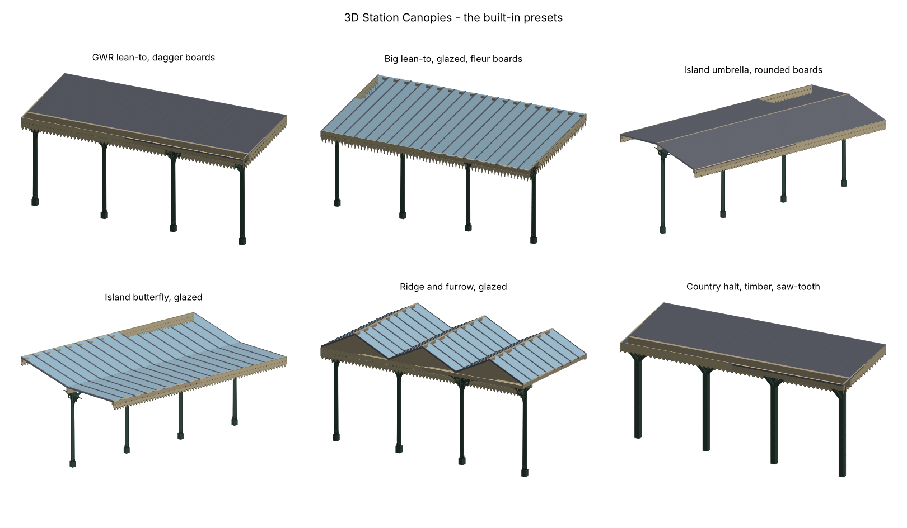

More in the [pictures](pictures) folder, and user guides in the [guides](guides) folder.

## Licence

Copyright (C) 2026 Phillip Edwards (Eddy). Written with the help of AI (Claude).

These plugins are free software under the GNU General Public License, version 3 or later — see
[LICENSE](LICENSE). You may use, share and change them; if you share changed versions, they must
stay under the same licence.
