# Eddy's 3D Plugins for IngeTrazo

A set of plugins (extensions) for [IngeTrazo](https://github.com/ingelibre/ingetrazo) for modelling
buildings and details, made for model railway buildings at 1:80 and 3D printing with a 0.4 mm
nozzle. All sizes are entered in real-world millimetres, so they work just as well at full size
or any other scale.

Every part they make is a closed, watertight solid with flat faces, ready to print.

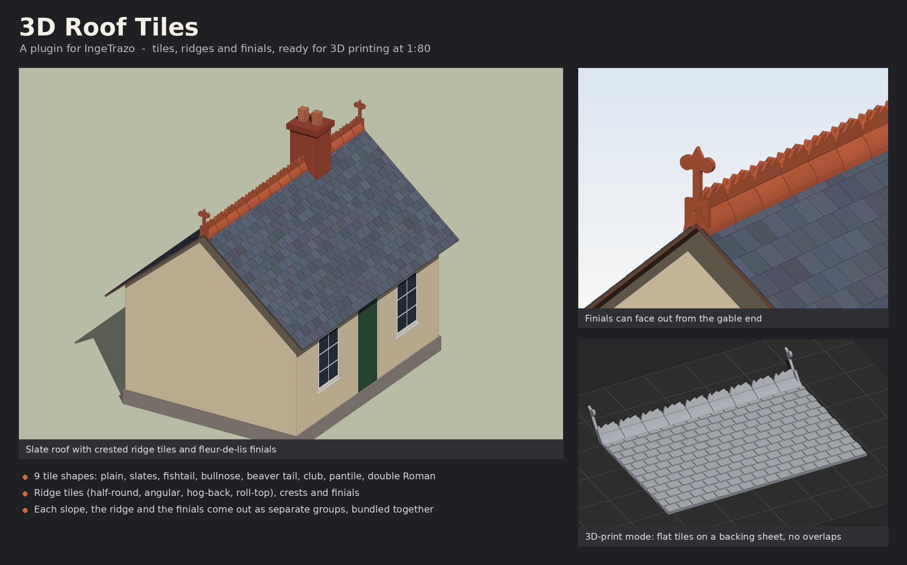

## The plugins

| Plugin | Shortcut | What it does |
|---|---|---|
| 3D Brick & Block Studio | Ctrl+Shift+T | Brick, block and stone walling on a wall face: bonds, row offsets, header and soldier courses; coursed ashlar, random rubble, dry-stone and Welsh slate; quoins up the corners and round openings, stone heads and sills; copings (slabs, saddleback, bricks on edge, cock and hen, upright slates); weathering and bomb-site damage (broken-down top, blast holes, broken and missing units, rubble at the foot, a backing sheet); rubble piles with timbers. Live 3D preview and a lettered Sizes drawing, presets, exact cuts round windows and doors. |
| 3D Period Windows | Ctrl+Alt+N | Sash, casement and industrial windows that fit the selected face, with round tops, panes, sills, heads and keystones. |
| 3D Period Doors | Ctrl+Alt+D | Panelled, half-glazed, ledged and braced, stable and sliding goods doors, with fanlights, steps, heads and keystones. |
| 3D Roof Tiles | Ctrl+Alt+R | Plain tiles, slates, shaped and profiled tiles, overlapping or flat for printing, with ridge tiles, crests, finials and lead flashings. Pick one roof face, or click the whole building (or Subframe's roof panels) and every roof piece is tiled at once. Each slope is its own group, with its tiles, ridge half, finials and flashing each a separate piece to print. Lettered Sizes key drawings. Opens with your last settings; move presets up and down the list. Tiles and ridge go round any chimney on the roof. |
| 3D Wood Planking | Ctrl+Alt+O | Timber boarding: flat, V-jointed, shiplap, weatherboard, board and batten or logs, with trims round openings, corner boards and derelict effects (rotted bottoms, holes, missing and skewed boards). |
| 3D Subframe | Ctrl+Alt+Y | A strengthening frame behind the walls and under the roof, at any scale: plates, corner posts, posts, lintels and sills round openings, studs, rails and braces, and on roofs of any shape the ridge, hip and verge rafters, rafters and purlins. Or draw lines and bars follow them, with square butt joints at corners and arches as one bent bar. Frames meet without overlapping, and every bar is its own piece, ready to lay flat on the print bed. Fascia, barge and soffit boards come out cream (or a colour you pick) so they stand out. |
| 3D Floor Plan | Ctrl+Alt+Shift+F | The shell of a building from its floor plan: rectangle, L, T or U from the overall size, your own corners typed in, or the edge of a level face you pick. Walls set in by their thickness, one section per side, the ends flat (long walls, short walls, swapped at each floor so corners interlock, or pinwheel) or mitred. Each floor's height typed in, or the total height divided by the floors. Floor slabs the storeys stand on (with a locating lip so they sit square) or drop-in floors on ledges. Room dividers with doorways, each one an object of its own on its floor - printed in place, laid flat beside the building, or joined to its floor. A base plate standing out or set in under the walls as a plinth, and a top plate. Long walls cut to fit the print bed. Every piece is its own plain group, ready to lay flat. Live plan and side preview, lettered key drawing. |
| 3D Openings | Ctrl+Shift+O | Window and door openings cut right through the walls: select one wall, several or the whole building and type the openings along each wall (W D W) - spread evenly, bunched in the middle or where you type - with square, segmental-arch or round tops. Or draw any shape on a wall and cut it through. Windows are holes and doorways are cut up from the bottom edge, with reveals all round, so each wall stays one piece that prints flat - and 3D Subframe and the Whole building pages of Period Windows and Period Doors find every opening. Live preview of the wall you pick, lettered key drawing. |
| 3D Fences & Gates | Ctrl+Alt+F | Picket, close-boarded, panel, post and rail, post and wire, steel palisade and iron railings on a dwarf wall, with gates and weathering. |
| 3D Gutters & Downpipes | Ctrl+Alt+G | Gutters, downpipes and fittings that join onto each other, with presets. |
| 3D Soil & Waste Pipes | Ctrl+Alt+W | Soil stacks and outside waste pipes with fittings that join onto each other, with presets. |
| 3D Wrap | Ctrl+Alt+U | Lays bricks course by course around round, square, many-sided or drawn chimneys (no seam, bonded corners, level courses stepping in up a taper), or bends any flat pattern round a solid. |
| 3D Chimneys | Ctrl+Alt+H | House chimney stacks that stand on the roof faces you pick, every brick cut to the slope, with oversailing courses, flaunching and pots; industrial mill and factory chimneys (square, octagonal or round, tapered, with plinth, bands, corbelled cap and coping); and six styles of chimney pot. Click the whole building and the stack stands on its ridge; the brickwork is one group and each pot a separate piece to print. Lettered key drawings. Window laid out like the other plugins: pictures and keys on the left, settings on the right. |
| 3D Corrugated Iron | Ctrl+Alt+I | Corrugated, box-profile and flat sheet cladding for walls and roofs, round any openings: flat-backed for 3D printing (joint lines and end-lap steps) or real lapped sheets on rails. Rust holes, rusted ragged bottoms, missing, skew and lifted sheets, flashings and corner trims. Click a whole building or shed to clad every roof slope, outside wall or both at once, each face its own group with every piece separate for printing. Ridge capping (angular, roll-top or half-round), and the sheets and capping go round any chimney. |
| 3D Station Canopies | Ctrl+Alt+C | Railway platform canopies: lean-to off a building's wall, island / umbrella over a platform (ridged or butterfly roof), and ridge and furrow with glazed ridges. Cast-iron columns with pierced spandrels or timber posts with knee braces, plain or glazed roofs, and dagger, rounded, fleur, saw-tooth or plain valancing as one flat printable strip. Live 3D preview and a lettered Sizes drawing. |
| 3D Show / Hide | Ctrl+Alt+Shift+H | One small floating window with a tab for each kind of thing to get out of the way while you work: each floor's walls and floor (and the plates) of a Floor Plan building, and the roof, fascia/barge/soffit boards and loose trusses over a Subframe. Ticked is shown; each click is one undo step. Floor Plan's 'Show floors...' and Subframe's 'Show / hide...' buttons open it on their own tab. |
| 3D Layers & Colours | Ctrl+Alt+V | Puts everything the building plugins make on a layer for its kind of work (Chimneys, Windows, Station canopies...) and colours each part by what it is (brick, slate, glass, canopy ironwork, mortar...), as materials you can change. Layers and colours can be renamed, recoloured or switched off, and Apply to selected organises groups already in the model in one undo step. |
| 3D Loft | Ctrl+Alt+L | Makes a solid between two or more profile faces, such as a square into a circle. |
| 3D Blend | Ctrl+Shift+B | Blends one object smoothly into another where they meet: a dome into a boiler, a post into a plinth, a handle onto a mug. Round, flared, soft cove or straight, or a round or square collar round the join with nuts, bolt heads or rivets. The blend sinks a little into both, so they print as one piece. |
| 3D Centre Finder | Ctrl+Alt+M | Finds the centre of a face, an edge or an object and shows its size: marks the centre with a guide point or centre lines, or moves another object so its centre lands there (a door central on a wall, a vent on a roof). |
| 3D Find & Replace | Ctrl+Alt+X | Swaps every copy of one part for another in one go, nested ones too: model a steam loco with light flat hex markers on every rivet spot so it stays quick to work on, then press Show detail to change them all into full rivets or bolts, and Go light to change them back. Each new part sits on its marker's base and faces the way it faced. Has a parts library in tabs (Markers, Rivets, Bolts & nuts, and tabs of your own): real-size markers, round-head rivets, hex bolt heads and nuts, plus your own components saved from any model. |
| 3D Place Along Line | Ctrl+Alt+S | Puts rivets, bolts or any part along a line drawn over a surface: click points on a boiler, cab side or tender and the line follows the surface between them (smooth or straight, open or a closed loop), or Wrap round rings a round, square or hex shape through one click. Or Use selected line puts them along lines of your own (or the loose lines in a selected group), and Round selected face goes round a face's edge, set in from it by the inset you give (round window holes too). So many between the ends or a pitch in mm, with a part on every clicked point and corner if you want. Each part stands square on the surface, base on the line, and can sink in until there's no gap under it on a curve. Uses the 3D Find & Replace parts library or any component; the row is one group you can edit again. |
| 3D Print Scaler | Ctrl+Alt+P | Scales the selected object to a chosen scale for printing and checks it fits your print bed. Exports STL, 3MF, OBJ or PLY in mm with full detail, can split a model into a separate part per group laid out on the bed (separate items in one 3MF), opens it in your slicer, and can stay open for scaling lots of parts. Model railway scales built in, plus your own. |
| 3D Scale Studio | Ctrl+Alt+K | Scale, repair and export in one window with pages and a live 3D preview. Scales the selected object in the work area to a model scale, a percentage, a size you type (in proportion or stretched) or from one model scale to another; splits it into coloured pieces laid out on the bed; checks and mends cracks, holes, doubled and back-to-front faces and thin walls; and exports for 3D printing (3MF, STL), other 3D programs (OBJ with colours, PLY), web, games and AR (GLB / glTF), CAD (DXF 3D faces), electronics 3D models (VRML), laser cutting and drawings (flat DXF / true-size SVG) or as a picture (PNG). Still has the real-to-model size converter, as a page and as a bar along the top. |
| 3D Timeline | Ctrl+Alt+T | A strip of every step along the bottom of the window: click a step to roll back, click a greyed one to go forward again. Checkpoints (full copies of the model, by hand or automatically every so many steps) are saved in a folder beside the file and can be restored into the model or opened on their own. The step list is kept inside the .igz, and the strip can be shown or hidden from the View menu. |
| 3D Notepad | Ctrl+Alt+J | A note pad that stays on screen and saves itself, with a real-to-model size converter. |
| 3D Quick Links | Ctrl+Alt+A | A small window over the work area with your folders, files and web pages: one click opens them. Keep a set of links for each job or video, add them with the buttons or by dragging them on. |
| 3D Plugins Toolbar | Ctrl+Alt+B | A toolbar with a button for each plugin, and a "3D Plugins by Eddy" submenu under Extensions. Split it into small toolbars of your own, and make workflow toolbars: the steps for a job (like making a building) in order, any plugin as often as you like, each step with its own note - the next step lights up and each gets a tick as you go. |
| 3D Better Icons | Ctrl+Alt+Y | Clearer colour icons for IngeTrazo's own toolbar buttons, drawn sharp at any size, with optional names under the icons (Ctrl+Alt+Q turns the names on or off). Remove the file to get the original icons back. |
| 3D Check for Updates | Ctrl+Alt+Shift+U | Finds new versions of these plugins, and new plugins, in IngeTrazo's extensions catalogue. Tick the ones you want and click Update ticked: each one is checked to make sure it's the real file, then put in for you, with your old copy kept as a backup. Install it first and it can put in the whole set in one go. Tick "Check when IngeTrazo starts" (off until you tick it) and it tells you, at most once a day, when something new is ready. |

Every window has pop-up notes on its boxes when you hover over them, and opens where you last
left it.

## Installing

### The easy way: from IngeTrazo, all in one go

1. In IngeTrazo, go to **Extensions**, then **Manage extensions**.
2. Search **Eddy** and install **3D Check for Updates** first. Then restart IngeTrazo.
3. Go to **Extensions** in the top bar, click **3D Check for Updates**, then click **Check now**.
4. All the plugins are listed under **New plugins**, already ticked. Untick any you don't want.
5. Click **Update ticked**, then restart IngeTrazo. You'll find them all under **Extensions** in
   the top bar, in **3D Plugins by Eddy**.

Tip: tick **Check when IngeTrazo starts** and it tells you when something new comes out.

Only want one or two? Search **Eddy** in **Manage extensions** and install just those instead.

### From this page (by hand)

All the plugins live in one folder, **3D_Eddys**, so they stay together and don't get mixed up
with other people's plugins. Every file in it starts with `ed3d_`, so you can tell at a glance
it's one of this set.

1. Download the files: click the green **Code** button above, then **Download ZIP**, and unzip it.
2. In IngeTrazo, choose **Extensions > Open extensions folder**.
3. Copy the whole **3D_Eddys** folder (from inside the `plugins` folder) into that folder.
4. Restart IngeTrazo. The plugins appear under **Extensions > 3D Plugins by Eddy**, and on the
   3D Plugins toolbar.

**Upgrading from the loose files?** Earlier versions put each plugin straight in the extensions
folder (`period_windows.py`, `roof_tiles.py` ...). Delete those old files when you copy the
3D_Eddys folder in, or you'll get every tool twice.

**Keeping up to date:** open **3D Check for Updates** (the **Updates** button on the 3D Plugins
toolbar, or **Extensions > 3D Plugins by Eddy**), click **Check now**, tick what you want and click
**Update ticked**. Restart IngeTrazo afterwards.

**Leaving one out:** rename its file inside 3D_Eddys so it no longer ends in `.py`
(for example `ed3d_loft.py.off`).

**Just one plugin?** You can also copy a single `ed3d_...py` file straight into the extensions
folder on its own - it works the same.

## Pictures

| | |
|---|---|
| 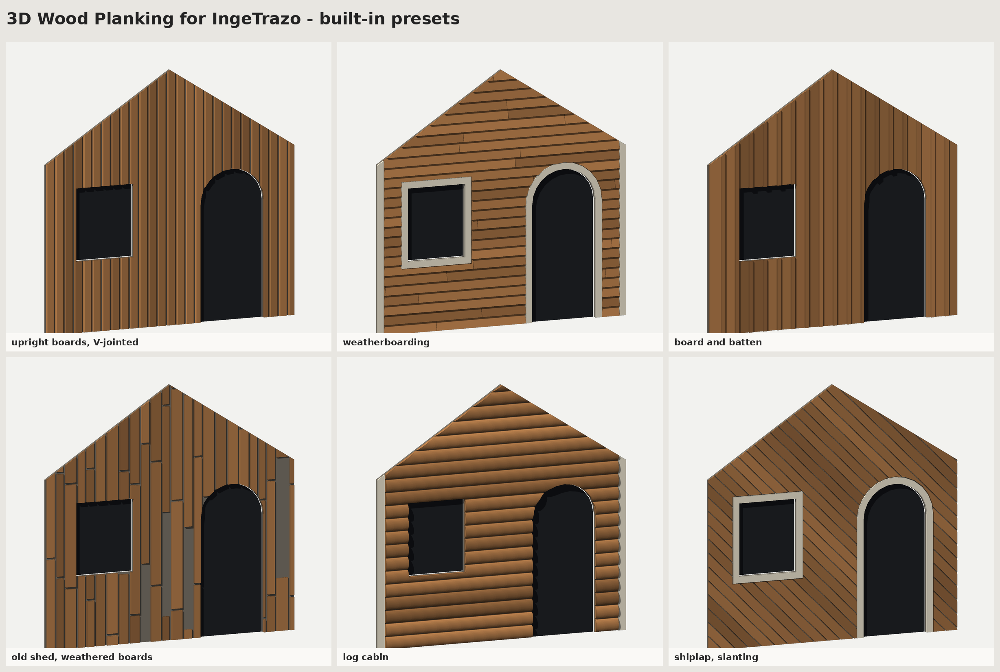 | 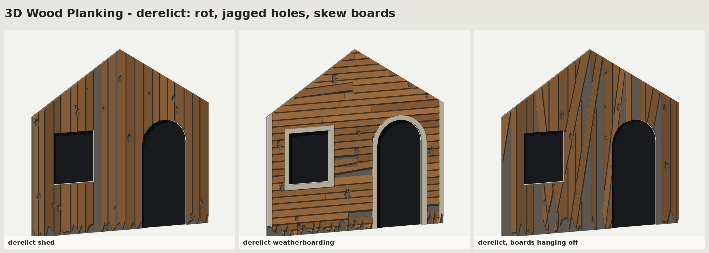 |
| 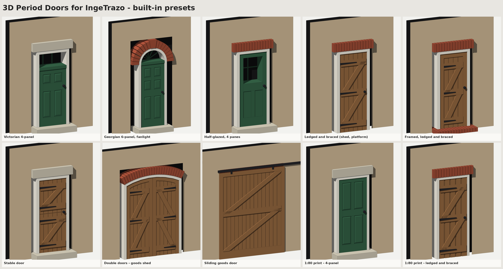 | 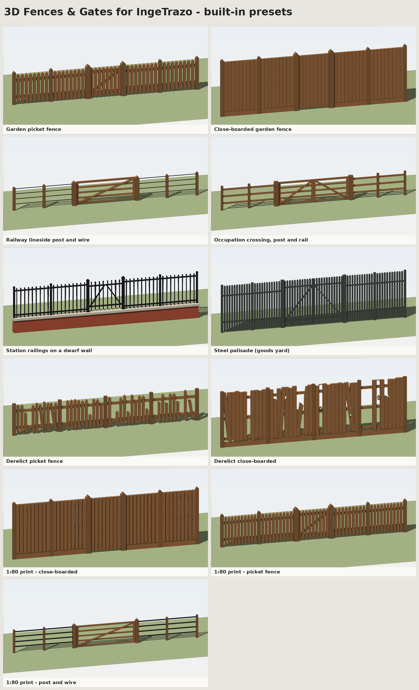 |
| 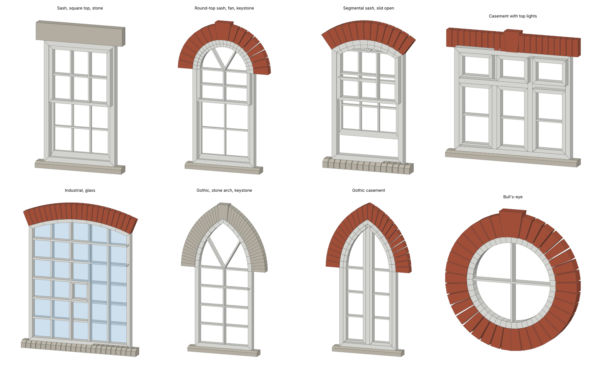 | 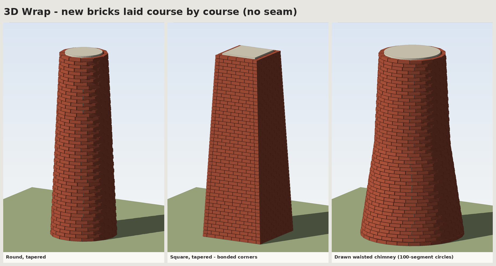 |
| 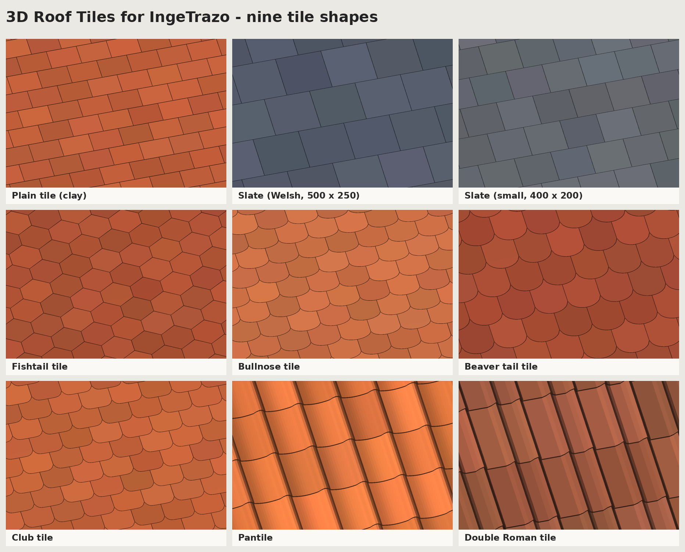 | 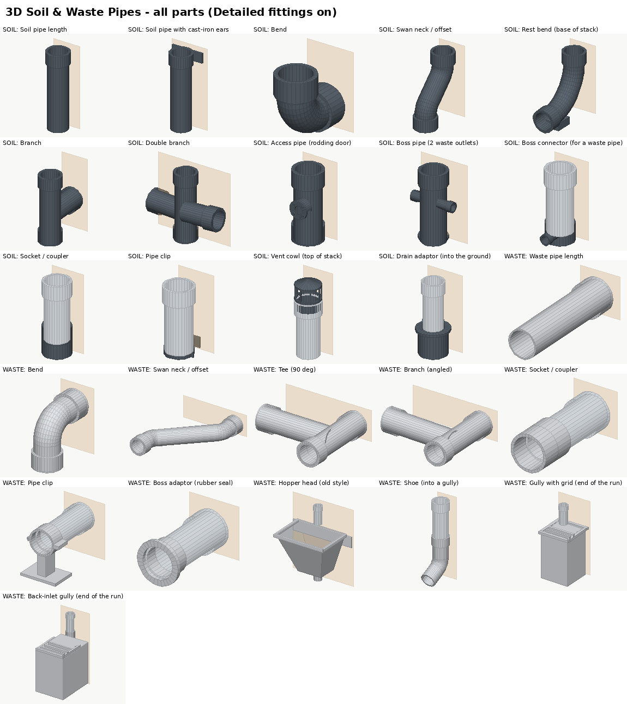 |

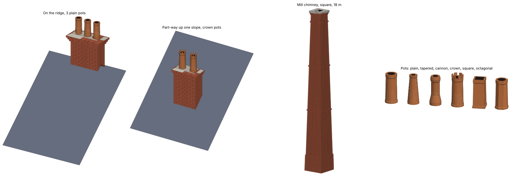

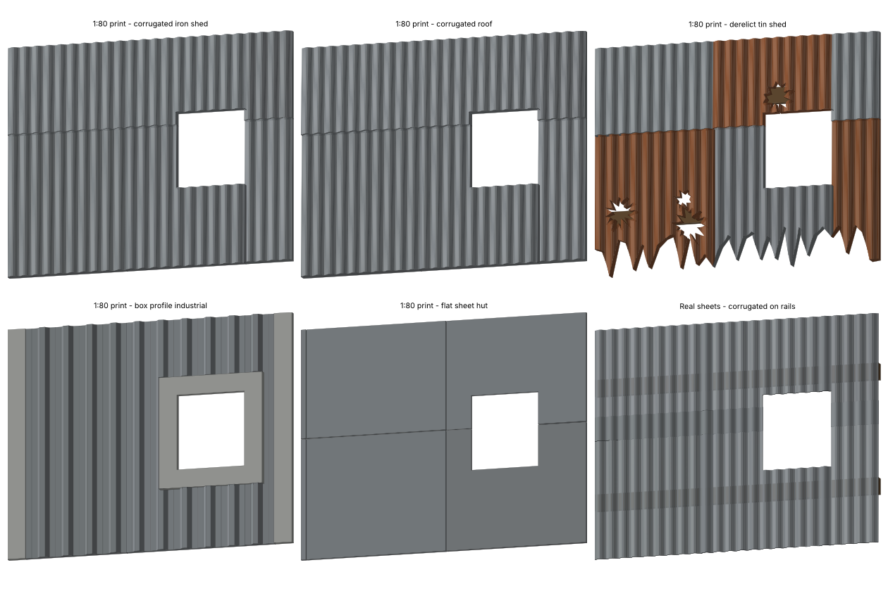

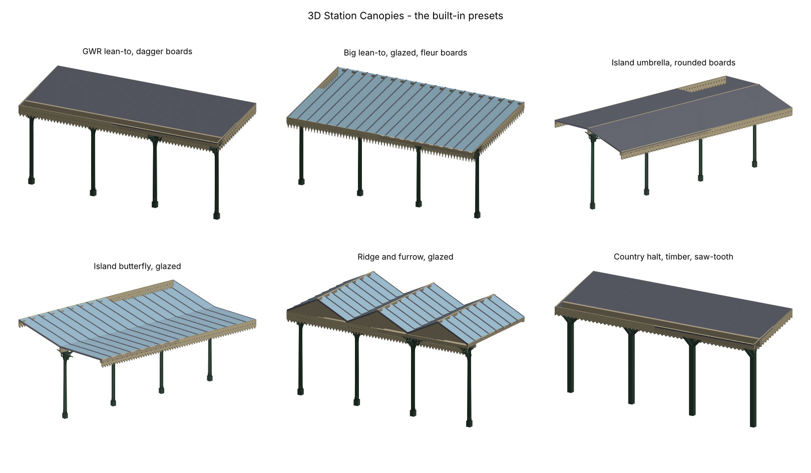

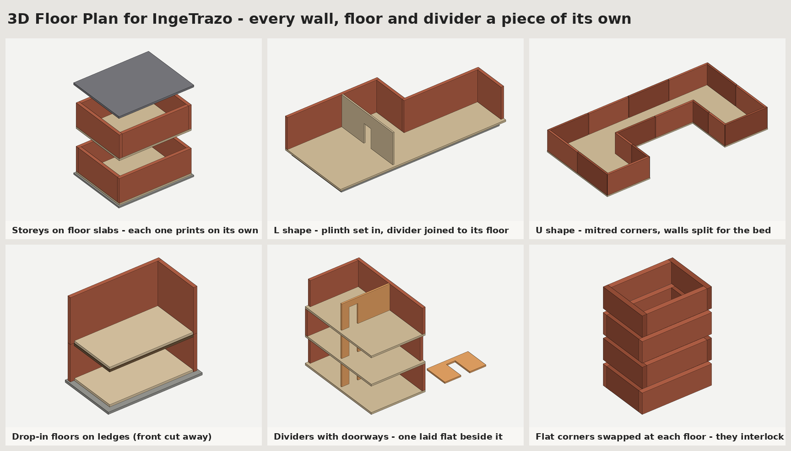

More in the [pictures](pictures) folder, and user guides in the [guides](guides) folder.

## Licence

Copyright (C) 2026 Phillip Edwards (Eddy). Written with the help of AI (Claude).

These plugins are free software under the GNU General Public License, version 3 or later — see
[LICENSE](LICENSE). You may use, share and change them; if you share changed versions, they must
stay under the same licence.
